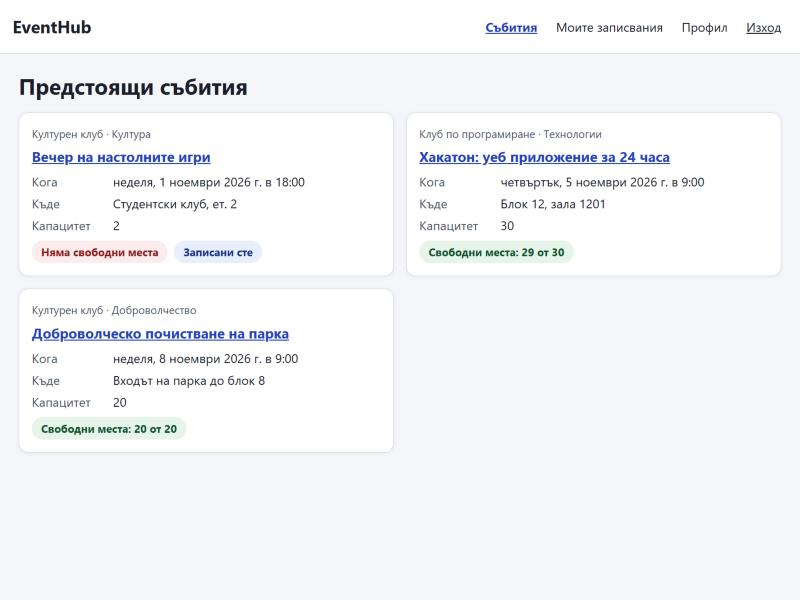
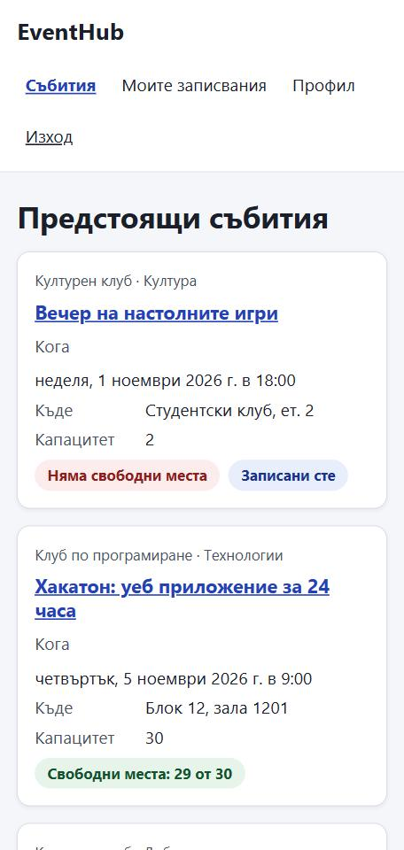
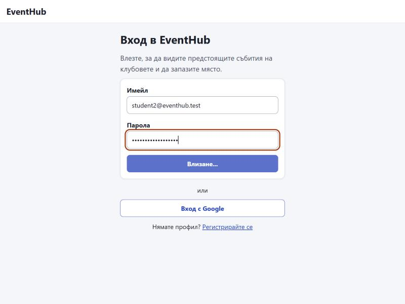
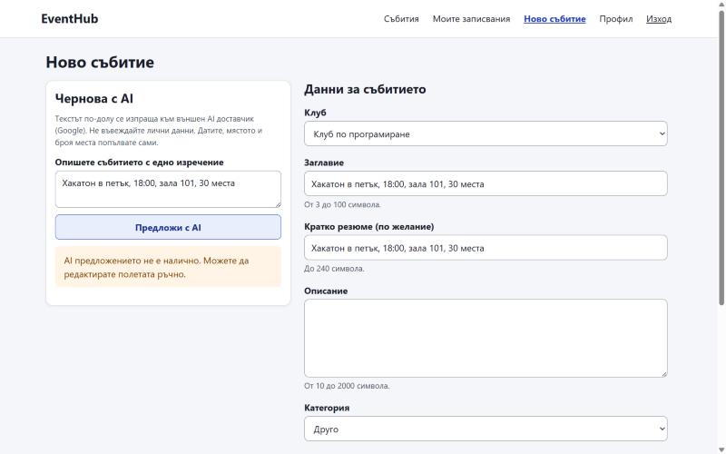
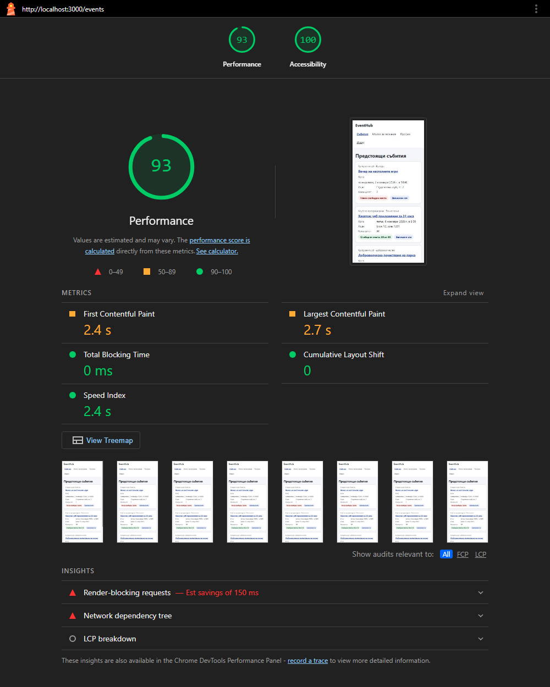

# UI checklist

<!-- Exercise 4 hands this in. Tick an item only when you have checked it, and replace
     the "how I checked" line with what you actually did. An unticked box is not a
     failure: it is a gap you then write into READINESS.md. A ticked box you cannot
     demonstrate at the defence is worse than an unticked one. -->

> Checked by the coding agent on 2026-10-29: automated tests, plus the app run locally (`npm run build && npm start`, seed data) in a Chromium browser pane. On 2026-10-30 the agent added the Lighthouse measurements (contrast, layout shift) and recorded the author's dark-mode decision. Re-check each ticked item yourself before the defence.

**Lighthouse 13.5.0** (command line, headless Chrome, production build on localhost, demo data, signed in with a demo session where the page needs one), 2026-10-30:

| Page | Form factor | Accessibility | Contrast audit | CLS | Performance |
|---|---|---|---|---|---|
| `/login` | mobile | 100 | pass, 0 elements failing | 0 | 94 |
| `/register` | mobile | 100 | pass, 0 elements failing | 0 | 94 |
| `/events` | mobile | 100 | pass, 0 elements failing | 0 | 93 |
| `/events` | desktop | 100 | pass, 0 elements failing | 0 | 100 |
| `/events/:id` | mobile | 100 | pass, 0 elements failing | 0 | 93 |
| `/my-registrations` | mobile | 100 | pass, 0 elements failing | 0 | 93 |
| `/account` | mobile | 100 | pass, 0 elements failing | 0 | 94 |
| `/organizer/events/new` | mobile | 100 | pass, 0 elements failing | 0 | 93 |

Command, per page: `npx lighthouse@13.5.0 http://localhost:3000/events --only-categories=accessibility,performance --extra-headers=<file with the session cookie>` (add `--preset=desktop` for the desktop row). Performance varies a few points between runs; CLS and the contrast result did not.

"Modern" is not a style. It is a short list of things a user notices when they are
missing: the screen tells you what is happening, you can get through it with a keyboard,
the text is readable, and nothing jumps around while it loads.

## Layout and typography

- [x] **One spacing scale and one type scale.** Sizes come from a small set of design tokens, not from numbers typed where they were needed.
  - how I checked: `client/src/styles/tokens.css` defines `--space-1…7`, `--font-size-*`, `--radius-*`, `--color-*`; `tests/ui/responsive.test.js` (AC-36) fails if `app.css` has a literal colour, a px value outside a media query, or a literal font-size/padding/margin/gap/radius, or a component uses `style={{}}`.
- [x] **Responsive at 380, 768 and 1280 pixels wide.** No horizontal scrollbar, no text running under another element.
  - how I checked: in the browser pane at a fixed viewport, `document.documentElement.scrollWidth` equalled the viewport on every screen at 380 (`/events`, `/events/:id`, `/my-registrations`, `/account`, `/organizer/events/new`, `…/edit`, `…/attendees`, `/login`); at 768 (`/events`: 2 columns, `/organizer/events/new`, attendees); at 1280 (`/events`: 3 columns). Screenshots below.
- [x] **Nothing jumps while the page loads.** Images and cards reserve their space before their content arrives.
  - how I checked: Lighthouse 13.5.0, Cumulative Layout Shift 0 on all eight runs in the table above. The first measurement found 0.088–0.117 on the signed-in pages at mobile width: `<main>` was drawn before the session check finished, and the navigation that then appeared wrapped onto two or three lines and pushed it down. `Layout.jsx` now shows one loading line until the check is done and draws `<main>` once, under the final header; `tests/ui/states.test.jsx` ("AC-37 the session check is one loading state…") keeps it that way. Lists still use fixed-height skeleton cards (`LoadingCards`), and there are no images.

## The four states, on every screen

A screen that only handles "it worked" is a screen that lies to the user on the day it matters.

- [x] **Loading.** Something tells the user the app is working, within about 100 ms.
  - how I checked: `tests/ui/states.test.jsx` (AC-37) holds each screen's request open and asserts its loading text or skeleton; screenshot `login-loading.jpg` shows "Влизане..." on the disabled button.
- [x] **Empty.** The screen says what this list is for and what to do next, instead of showing nothing.
  - how I checked: same file: "Няма предстоящи събития" (with "Създайте събитие" for organizers), "Още нямате записвания", "Още няма записани участници", "Първо създайте своя клуб", "Събитието липсва".
- [x] **Error.** A sentence a person can read. Never a raw JSON body, never a stack trace, never just "Error".
  - how I checked: same file: network failure, 403, 404, 409 and 500 answers each show the server's Bulgarian sentence with a "Опитай отново" button where retrying makes sense; the test asserts no JSON or stack text on the page.
- [x] **Success.** The user can see that what they did took effect, without reloading the page to find out.
  - how I checked: same file and `tests/ui/keyboard.test.jsx`: registering updates the free seats and shows "Записахте се успешно"; cancelling, saving, deleting and adding a password each show a confirmation.

## Keyboard and accessibility

- [x] **The main flow works with the keyboard alone.** Sign in, do the core action, sign out, without touching the mouse.
  - how I checked: `tests/ui/keyboard.test.jsx` (AC-38) signs in, opens an event, registers with Space and cancels with Enter using Tab/Shift+Tab only; by hand in the browser pane I signed in with Tab and Enter. Sign-out by keyboard was not tested separately (it is a normal `<button>` in the nav).
- [x] **The focused element is visible.** A `:focus-visible` outline that is not switched off.
  - how I checked: `:focus-visible { outline: var(--focus-width) solid var(--color-focus) }` in `app.css`; the keyboard test fails if any interactive selector sets `outline: none`; the focus ring is visible on the password field in `login-loading.jpg`.
- [x] **Text contrast is at least 4.5:1.** Name the tool you measured with.
  - how I checked: **Lighthouse 13.5.0**, whose "Background and foreground colors have a sufficient contrast ratio" audit (axe-core, WCAG AA 4.5:1 for normal text) passed with 0 failing elements on all eight runs above (screenshot below). Lighthouse only sees what is on screen when the page has loaded, so the notices that appear later (success, warning, error, the AI notes) are covered by `tests/ui/accessibility.test.js` (AC-39): the WCAG 2.x luminance formula over every text/background token pair (all ≥ 4.5:1) and focus/border colours (≥ 3:1).
- [x] **Every input has a label** a screen reader reads, not just placeholder text.
  - how I checked: every input is found in the tests with `getByLabelText(...)`, which only works through a real `<label for>`; hints and errors are linked with `aria-describedby`.
- [x] **The page has a correct `<title>` and `lang`.**
  - how I checked: `client/index.html` has `lang="bg"` and "EventHub — студентски клубни събития"; each screen sets "<screen> · EventHub" (`useDocumentTitle`), visible in the browser tab.
- [x] **Touch targets are at least 44 pixels.**
  - how I checked: buttons, inputs and nav links use `min-height: var(--size-touch)` (2.75rem = 44 px); asserted in `tests/ui/responsive.test.js`.

## The model feature

- [x] **It shows that it is thinking.** A model call is slow and a free service may have been asleep; a frozen button is the worst possible answer.
  - how I checked: `tests/ui/ai-panel.test.jsx` (AC-27) holds the request open: the button reads "Генериране...", is disabled and `aria-busy`.
- [x] **It shows when it failed,** and the rest of the screen still works.
  - how I checked: by hand with no `GEMINI_API_KEY` (screenshot `ai-fallback.jpg`): the warning "AI предложението не е налично…" appears and the form is filled with the fallback; `tests/ui/ai-panel.test.jsx` (AC-28, AC-29) saves the event by hand after a fallback and after a failed request.
- [x] **The user can tell the model's suggestion from a fact.** It is labelled as a suggestion, not presented as data the app knows.
  - how I checked: a model answer shows "Това е предложение от AI, не проверени данни. Прегледайте полетата преди запис."; the panel says dates, place and seats are filled in by the organizer, and the draft never touches them (asserted in `ai-panel.test.jsx`).

## Decisions

- [x] **Dark mode, or a written decision not to have one.**
  - what I decided and why: **no dark mode** (the author's decision, 2026-10-30). It is not among the goals in `SPEC.md`, and a second palette is a second set of colours to measure and keep at 4.5:1 on every screen and state; one light palette, measured, is the better use of the time. The page follows the light palette even when the system is dark. Every colour is a token in `client/src/styles/tokens.css`, so adding one later means a `@media (prefers-color-scheme: dark)` block there, then measuring again.

## Evidence

Screenshots from the browser pane, 2026-10-29:

Lighthouse report for `/events` at mobile width, 2026-10-30:

